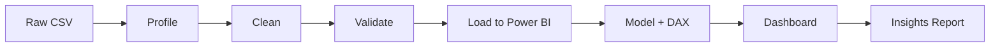

# 🏥 Disease Surveillance Capstone: Clean, Analyse & Visualise in Power BI


A hands-on capstone in which you turn a **messy hospital-admissions dataset** into a **clean, trustworthy, interactive Power BI dashboard** and present actionable health insights.

---

## 📑 Table of Contents

1. [Scenario](#-scenario)
2. [Learning Objectives](#-learning-objectives)
3. [Repository Contents](#-repository-contents)
4. [Dataset Description](#-dataset-description)
5. [Known Data-Quality Issues](#-known-data-quality-issues)
6. [Getting Started](#-getting-started)
7. [Project Workflow](#-project-workflow)
8. [Phase-by-Phase Guide](#-phase-by-phase-guide)
9. [What the Final Dashboard Should Look Like](#-what-the-final-dashboard-should-look-like)
10. [Deliverables](#-deliverables)
11. [Grading Rubric](#-grading-rubric)
12. [Sanity-Check Benchmarks](#-sanity-check-benchmarks)
13. [Tips & Common Pitfalls](#-tips--common-pitfalls)
14. [Instructor Notes](#-instructor-notes)
15. [Disclaimer](#-disclaimer)

---

## 🎯 Scenario

You have just joined the **Regional Health Intelligence Unit** of a national health service. Hospitals in all 16 regions submit admission records every month. Because clerks use different systems and spellings, the combined file is **inconsistent and incomplete**.

The Director of Health Services needs answers to:

- 🦟 Which diseases put the most pressure on hospitals?
- 🗺️ Which regions carry the highest disease burden and treatment cost?
- 👥 Who is affected most, by age group and gender?
- 📈 Are there seasonal or yearly trends we should plan for?

**Your mission:** clean the data → document your decisions → build the dashboard → present insights and recommendations.

---

## 🧠 Learning Objectives

By completing this project you will be able to:

- Profile a raw dataset and quantify its quality problems
- Standardise categorical text (spelling, case, whitespace, abbreviations)
- Choose and **justify** a missing-value strategy
- Detect and handle outliers, impossible values and duplicates
- Build a data model with a **Date table** and **DAX measures**
- Design a clear, interactive **Power BI** dashboard
- Communicate findings to non-technical decision makers

---

## 📦 Repository Contents

| File | Audience | Purpose |
|------|----------|---------|
| `README.md` | Everyone | This guide |
| `Health_Disease_Capstone_Project.ipynb` | Students | Project brief, data dictionary, starter code, DAX, wireframes, rubric |
| `health_disease_raw.csv` | Students | Raw, dirty dataset (5,000 rows × 6 columns) |
| `generate_dataset.py` | **Instructors only** | Reproducible generator; reveals every injected error |

---

## 📊 Dataset Description

**File:** `health_disease_raw.csv` · **Size:** 5,000 rows × 6 columns · **Period:** 2022-01-01 → 2024-12-30

| # | Column | Expected Type | Description |
|---|--------|---------------|-------------|
| 1 | `Admission_Date` | Date | Date the patient was admitted |
| 2 | `Region` | Text | Region of the hospital (16 regions of Ghana) |
| 3 | `Age` | Whole number | Patient age in years |
| 4 | `Gender` | Text | Target values: `Male` / `Female` (`Unknown` if truly missing) |
| 5 | `Disease` | Text | Primary diagnosis, target of **12 standard diseases** |
| 6 | `Treatment_Cost_GHS` | Decimal | Total treatment cost in Ghana cedis (GHS) |

**Target disease list:**
Malaria · Hypertension · Diabetes · Typhoid · Pneumonia · Tuberculosis · Cholera · HIV/AIDS · Asthma · Anaemia · Sickle Cell Disease · Hepatitis B

**Sample of the raw data**

```csv
Admission_Date,Region,Age,Gender,Disease,Treatment_Cost_GHS
2023-01-21,Greater Accra,13.0,Male,Pneumonia,914.45
2023-11-19,,48.0,Male,Hypertenshun,246.47
2024-06-22,Ashanti,57.0,female,diabetes ,1674.32
2023-03-18,Greater Accra,51.0,Female,Anaemia,
```

---

## 🔍 Known Data-Quality Issues

The file was **deliberately damaged**. Expect to find at least:

| # | Issue | Where | Example |
|---|-------|-------|---------|
| 1 | Mis-spelt / inconsistent names | `Disease` | spelling errors, wrong case, trailing spaces, abbreviations |
| 2 | Mis-spelt / inconsistent labels | `Gender` | abbreviations, case differences, typos, synonyms |
| 3 | Missing numeric values | `Age`, `Treatment_Cost_GHS` | blank cells |
| 4 | Missing categorical values | `Gender`, `Region` | blank cells |
| 5 | Inconsistent labels | `Region` | upper-case, alternative naming |
| 6 | Impossible values | `Age`, `Treatment_Cost_GHS` | negative ages, ages above 100, negative costs |
| 7 | Duplicate records | all columns | exact repeated rows |

> 💡 This list is **not guaranteed to be complete**. Profile the data thoroughly and document anything else you find.

---

## 🚀 Getting Started

### Prerequisites

- Python 3.9+ with `pandas`, `numpy` and `jupyter`
- [Power BI Desktop](https://powerbi.microsoft.com/desktop/) (Windows)

### Setup

```bash
# 1. Install dependencies
pip install pandas numpy jupyter

# 2. Launch the notebook
jupyter notebook Health_Disease_Capstone_Project.ipynb
```

Keep `health_disease_raw.csv` in the same folder as the notebook. **Never overwrite the raw file.**

---

## 🔄 Project Workflow



---

## 🛠️ Phase-by-Phase Guide

### Phase 1: Profile the Raw Data
Use `info()`, `isna().sum()`, `value_counts()`, `describe()` and `duplicated().sum()` to answer:

1. How many disease spellings exist vs. how many should?
2. How many gender labels exist vs. how many should?
3. What % of `Age` and `Treatment_Cost_GHS` is missing?
4. Are the min/max of age and cost plausible?
5. How many duplicate rows are there?

### Phase 2: Clean the Data
Clean in **Python**, in **Power Query**, or both, but document every step.

| Task | Suggested approach |
|------|--------------------|
| Trim whitespace, fix case | `str.strip()`, `str.title()` / Power Query *Format* |
| Standardise `Disease` | Mapping dictionary `{wrong: right}` + `.replace()` |
| Standardise `Gender` | Map to `Male` / `Female`; leave unknown as `Unknown` |
| Standardise `Region` | Fix casing and alternative names; missing → `Unknown` |
| Parse dates | `pd.to_datetime()` |
| Impossible values | Define valid ranges (e.g. Age 0–110, Cost > 0) → set invalid to missing |
| Missing numerics | Compare ≥ 2 methods (overall median vs. **median by disease**) and justify |
| Duplicates | `drop_duplicates()` |
| Feature engineering | `Age_Group`, `Year`, `Month`, `Quarter`, optional `Cost_Band` |

**Validation checklist (all must pass):**

- [ ] `Disease` has exactly **12** unique values
- [ ] `Gender` contains only `Male`, `Female`, `Unknown`
- [ ] `Region` has **16** valid regions (+ `Unknown` if kept)
- [ ] No unexplained missing values in `Age` or `Treatment_Cost_GHS`
- [ ] Age in **0–110**; Cost **> 0**
- [ ] No duplicate rows
- [ ] `Admission_Date` is a date type
- [ ] Exported as `health_disease_clean.csv`

### Phase 3: Build the Data Model
1. **Get Data → Text/CSV** → load the cleaned file.
2. Confirm data types.
3. Create a Date table:

```DAX
DateTable =
ADDCOLUMNS(
    CALENDAR(DATE(2022,1,1), DATE(2024,12,31)),
    "Year", YEAR([Date]),
    "MonthNo", MONTH([Date]),
    "Month", FORMAT([Date], "MMM"),
    "Quarter", "Q" & QUARTER([Date])
)
```

4. Relate `DateTable[Date]` → `Admission_Date` (one-to-many) and mark it as a date table.
5. *(Bonus)* Create Disease and Region dimension tables for a star schema.

**Required DAX measures**

```DAX
Total Patients     = COUNTROWS(HealthData)
Total Cost         = SUM(HealthData[Treatment_Cost_GHS])
Avg Cost / Patient = DIVIDE([Total Cost], [Total Patients])
Avg Age            = AVERAGE(HealthData[Age])
Female %           = DIVIDE(CALCULATE([Total Patients], HealthData[Gender]="Female"), [Total Patients])
Patients Last Year = CALCULATE([Total Patients], SAMEPERIODLASTYEAR(DateTable[Date]))
YoY Growth %       = DIVIDE([Total Patients] - [Patients Last Year], [Patients Last Year])
Top Disease        = FIRSTNONBLANK(TOPN(1, VALUES(HealthData[Disease]), [Total Patients]), 1)
```

### Phase 4: Build the Dashboard
See [What the Final Dashboard Should Look Like](#-what-the-final-dashboard-should-look-like).

### Phase 5: Insights & Recommendations
Write a one-page summary (or 5-slide deck) that answers:

1. Top 3 diseases by patient count **and** by total cost. Are they the same?
2. Which regions carry the highest burden? Highest cost per patient?
3. Which age groups and genders are most affected by each disease?
4. Is there a seasonal pattern? Is volume growing year-on-year?
5. **Three actionable recommendations** for the Director, each tied to a specific chart.
6. Limitations of the data and your imputation choices.

---

## 🖥️ What the Final Dashboard Should Look Like

### Page 1: Executive Overview

```
┌──────────────────────────────────────────────────────────────────────────────┐
│  🏥 NATIONAL DISEASE SURVEILLANCE DASHBOARD                 [Year ▾] [Gender]│
├───────────┬───────────┬───────────┬───────────┬───────────────────────────────┤
│ Total     │ Total     │ Avg Cost  │ Avg Age   │  Top Disease card             │
│ Patients  │ Cost GHS  │ / Patient │           │                               │
├───────────┴───────────┴───────────┴───────────┴───────────────────────────────┤
│  Patients by DISEASE        │  Monthly TREND (line, by Year)                  │
│  (horizontal bar, sorted)   │  with seasonality visible                       │
├─────────────────────────────┼─────────────────────────────────────────────────┤
│  Patients by REGION         │  Gender split (donut)  │  Age-group (column)    │
│  (filled map or bar)        │                        │                        │
└──────────────────────────────────────────────────────────────────────────────┘
```

### Page 2: Cost & Demographics Deep-Dive

```
┌──────────────────────────────────────────────────────────────────────────────┐
│ Slicers: Disease | Region | Age Group                                        │
├────────────────────────────────┬─────────────────────────────────────────────┤
│ Avg cost by disease (bar)      │ Disease × Age Group (matrix, heat colours)  │
├────────────────────────────────┼─────────────────────────────────────────────┤
│ Cost vs Age (scatter, bubble = │ Top-10 table: Region, Patients, Total Cost, │
│ patients, legend = disease)    │ Avg Cost (conditional formatting data bars) │
└────────────────────────────────┴─────────────────────────────────────────────┘
```

### Page 3 (optional): Data Quality & Methodology
Rows before/after cleaning, issues found, imputation method and assumptions.

### Minimum visual requirements

| Visual | Purpose |
|--------|---------|
| ≥ 4 KPI cards | Headline numbers |
| Bar / column chart | Disease burden |
| Line chart | Monthly trend |
| Map or ranked bar | Regional burden |
| Donut or pie | Gender split |
| Matrix / heat-map | Disease × Age group |
| ≥ 3 slicers (Year, Gender, Disease/Region) | Interactivity |
| Tooltip or drill-through | At least one (e.g. Region → detail page) |

### Design guidelines

- One consistent palette (1 primary + 1 accent + grey); reserve red/orange for alerts
- Title and subtitle on every page; label axes and units (**GHS**, **years**)
- Key KPIs **top-left**; reading flow left→right, top→bottom
- Maximum ~8 visuals per page; align to the grid; leave white space
- Sort bars descending; avoid 3-D; no more than 6 donut slices
- Test at 1280×720 and check the mobile layout
- *(Bonus)* page navigation buttons and a **Reset filters** bookmark

---

## 📤 Deliverables

| # | Deliverable | Format |
|---|-------------|--------|
| 1 | Completed notebook (cleaning code + notes) | `.ipynb` |
| 2 | Cleaned dataset | `health_disease_clean.csv` |
| 3 | Power BI dashboard (2–3 pages) | `.pbix` |
| 4 | Insights report or slide deck | `.pdf` / `.pptx` |
| 5 | Data-cleaning log (issue → decision → rows affected) | table in notebook |
| 6 | 5-minute demo recording *(optional)* | `.mp4` |

---

## 🏆 Grading Rubric

| Area | Marks | Excellent work looks like |
|------|:-----:|---------------------------|
| Data profiling | 10 | All issues identified with evidence (counts, tables) |
| Data cleaning | 25 | Every validation check passes; reproducible code; clear logic |
| Missing-data justification | 10 | Compares ≥ 2 methods and defends the choice |
| Data model & DAX | 15 | Date table, correct relationships, ≥ 6 working measures |
| Dashboard design & interactivity | 20 | Meets minimum requirements; clean, consistent, professional |
| Insights & recommendations | 15 | Evidence-based, actionable, tied to visuals |
| Documentation & presentation | 5 | Clear notes, tidy files, confident explanation |
| **Total** | **100** | |

**Bonus (+10):** clean everything in Power Query · star schema · drill-through page · row-level security for a regional manager · a Python visual.

---

## ✅ Sanity-Check Benchmarks

After sensible cleaning, your numbers should land **close to** these (small differences from imputation choices are fine):

| Metric | Expected (approx.) |
|--------|--------------------|
| Rows after de-duplication | ≈ **4,961** |
| Average age | ≈ **32–33 years** |
| Average treatment cost | ≈ **GHS 950–1,000** |
| Most common disease | **Malaria** |
| Highest average cost | **HIV/AIDS** |
| Most patients by region | **Greater Accra**, then **Ashanti** |

---

## 💡 Tips & Common Pitfalls

- Run `value_counts()` **before and after** every fix.
- Don't impute blindly. Use **group-wise** medians (e.g. by disease) so values stay realistic.
- Keep the raw file untouched; build mapping dictionaries so your steps can be re-run.
- In Power BI, set **Summarize by → Don't summarize** for `Age` and `Year`.
- Test every slicer: each visual should respond sensibly.
- Document *why*, not just *what*, for each cleaning decision.

---

## 👩‍🏫 Instructor Notes

- `generate_dataset.py` is seeded (`2026`), so it reproduces the same dataset. Change the seed or the error rates to create new versions per cohort.
- Keep this script away from students, since it reveals every injected error.
- Injected error rates (approx.): disease 30%, gender 18%, `Age` missing 7%, cost missing 9%, plus 12 impossible values and 40 duplicated rows.
- To regenerate:

```bash
python generate_dataset.py
```

---

## ⚠️ Disclaimer

All data is **synthetic**, generated for training purposes only. It does not represent real patients, hospitals or health statistics and must not be used for real-world health decisions.
